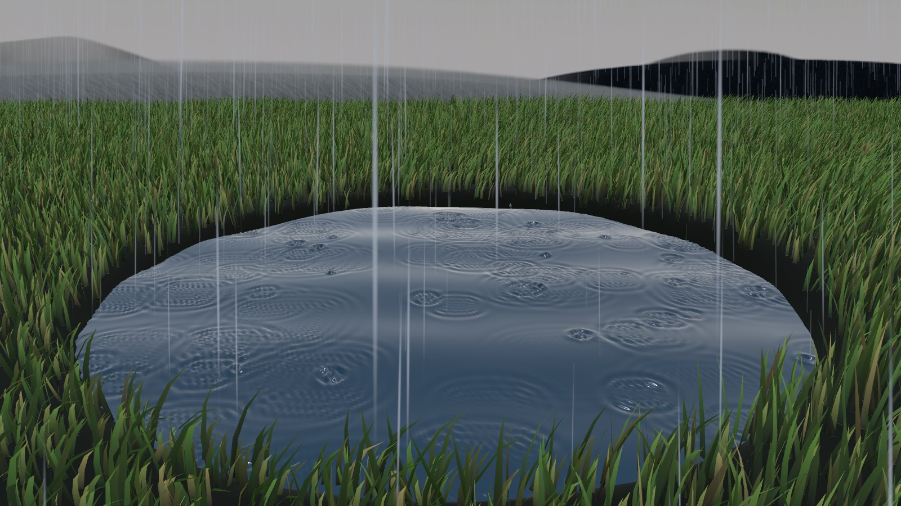
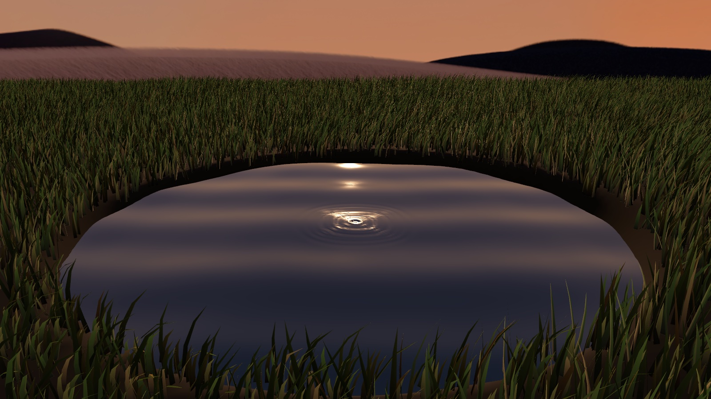
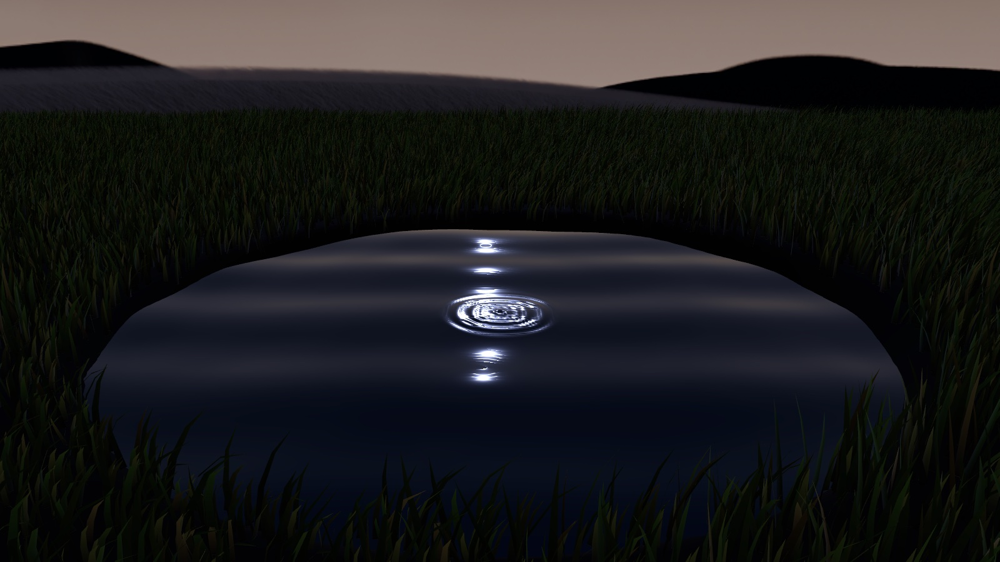
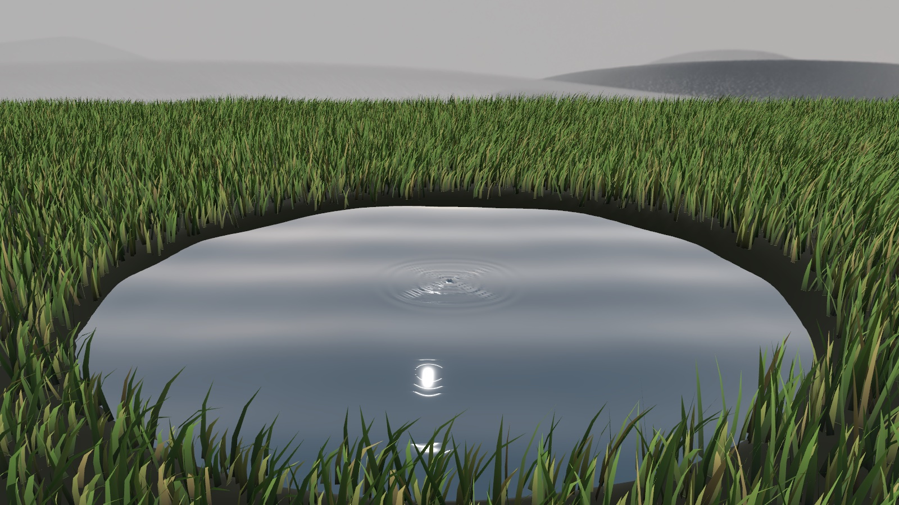
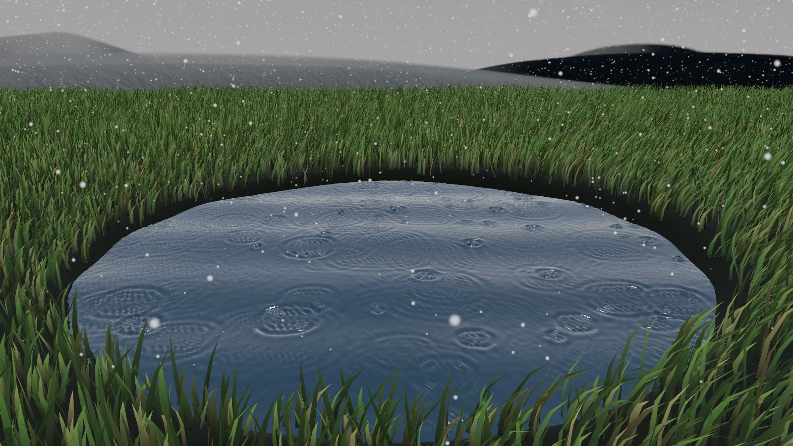

# ImmersiveWeather



Weather-driven environments for RealityKit immersive spaces:

- **`WaterSurfaceEntity`** is a GPU-simulated water surface with ripples, layered ambient waves and Perlin noise, and rain drops that react to the weather.
- **`WeatherEnvironmentEntity`** swaps the sky, image-based lighting and ambient sound for each weather condition, and adds falling rain or snow.
- **`WeatherController`** keeps both in sync as the weather and water mood change.

Weather (`clearMorning`, `clearNight`, `foggy`, `rainy`, `snowy`) and *water mood* (`peaceful`, `moderate`, `turbulent`) are independent. Mood sets how agitated the water is. Rain or snow overrides the mood's drops with a shower over the whole surface.

## Gallery

All five conditions use the same scene. The sky, lighting, rain, snow and water come from this package, and the grass from [RealityGrass](https://github.com/Cleozhang999/RealityGrass).

| | |
|---|---|
|  |  |
| `clearMorning` | `clearNight` |
|  |  |
| `foggy` | `rainy` |
|  | |
| `snowy` | |

*Rendered offscreen with RealityKit on macOS. The sky panoramas are renders from the NEST XR project by Cleo Zhang. They are not part of the package.*

## Requirements

- visionOS 2 / iOS 18 / macOS 15 or later
- Xcode 16 or later, with the Metal toolchain installed

## Installation

```swift
.package(url: "https://github.com/Cleozhang999/ImmersiveWeather.git", from: "0.2.0")
```

## Usage

```swift
import ImmersiveWeather
import RealityKit
import SwiftUI

struct PondSpace: View {
    // Share this with a window that shows a Picker bound to `weather.condition`.
    @State private var weather = WeatherController(catalog: .prefixed("Meadow"))

    var body: some View {
        RealityView { content in
            content.add(weather.environment)

            let pond = try? await WaterSurfaceEntity(size: [3, 3], resolution: [128, 128])
            if let pond {
                pond.position = [0, 0, -2]
                weather.attach(pond)
                content.add(pond)
            }
        }
        .task(id: weather.condition) {
            await weather.refreshEnvironment()
        }
    }
}
```

### Water on its own

```swift
let water = try await WaterSurfaceEntity(size: [2, 2])
water.surfaceParameters = .preset(for: .peaceful)
water.surfaceParameters.dropsPerSecond = 5
water.disturb(atLocal: [0.2, 0, -0.3])   // for example, from a SpatialTapGesture
```

### Rain and snow

`WeatherEnvironmentEntity` adds falling rain or snow by itself when the condition is `.rainy` or `.snowy`. No assets are needed. Precipitation falls in a box centered on the entity, which you can resize and thin out:

```swift
weather.environment.precipitationArea = [6, 4, 6]   // width, height, depth in meters
weather.environment.precipitationDensity = 0.5      // fewer particles on device
```

### Bringing your own assets

The package ships no images or sounds. `WeatherAssetCatalog.prefixed("Meadow")` looks in your app bundle for:

| Part | File |
|---|---|
| Sky (equirectangular) | `Meadow_sky_<key>.png` |
| Lighting (equirectangular, HDR recommended) | `Meadow_ibl_<key>.hdr` |
| Rain/snow ambience | `rain.mp3` |

where `<key>` is `sunny_morning`, `sunny_night`, `foggy` or `rainy` (snow uses the rain assets). For any other layout, pass your own closure:

```swift
WeatherAssetCatalog(bundle: .main) { condition in
    WeatherAssetNames(skybox: "sky-\(condition.rawValue).jpg", imageBasedLight: "light.hdr")
}
```

Missing files don't crash the app. `refreshEnvironment()` records them in `weather.loadFailures`.

Sky images are mapped onto a sphere, so they need to be **2:1 equirectangular** panoramas, with the horizon across the middle. A wide strip panorama that covers only part of the sky must be padded to 2:1 first, or its horizon will end up in the wrong place.

## How the water works

Each frame, per surface:

1. Maybe drop a ripple, with a Poisson-distributed chance based on `dropsPerSecond` that does not depend on frame rate.
2. Run five substeps of a shallow-water velocity and height integration.
3. Add four sine waves and two drifting octaves of Perlin noise.
4. Derive normals and write positions and normals into a `LowLevelMesh`.

## Acknowledgements

The height-map mesh and ripple simulation are adapted from Apple sample code. See [NOTICE.md](NOTICE.md).

## Testing

```bash
swift test
```

## License

MIT for original code. See [LICENSE](LICENSE) and [NOTICE.md](NOTICE.md).
